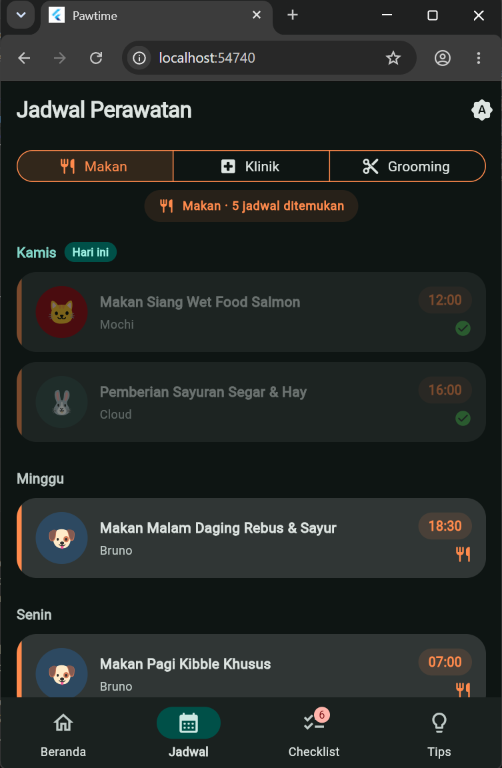
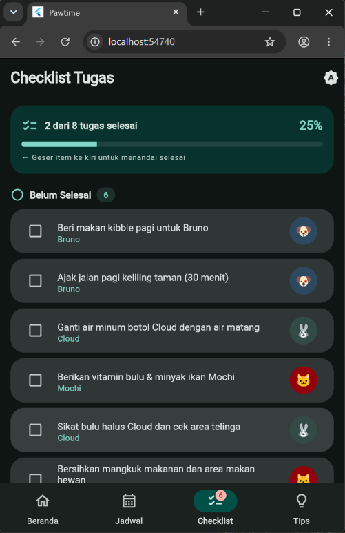
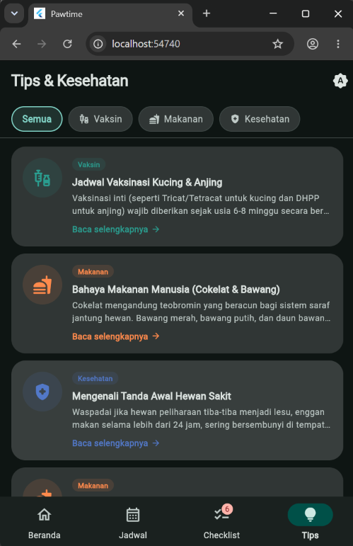
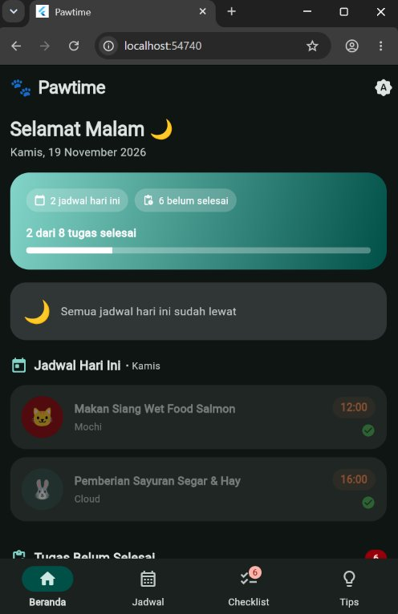
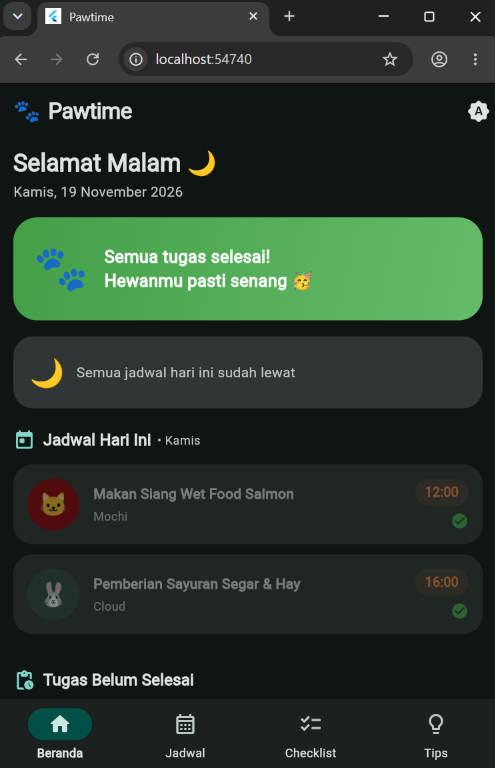
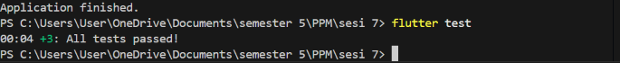

# Pawtime 🐾

## Nama Aplikasi & Tema
**Pawtime** adalah aplikasi pengingat jadwal perawatan hewan peliharaan (jadwal makan, klinik, dan grooming). 

Alasan memilih tema ini adalah karena memelihara hewan peliharaan memerlukan kedisiplinan dan rutinitas yang teratur, mulai dari pemberian pakan tepat waktu, kunjungan klinik/vaksinasi berkala, hingga perawatan kebersihan (grooming). Banyak pemilik hewan peliharaan kesulitan melacak jadwal dan tugas harian yang berbeda untuk masing-masing hewan mereka. Aplikasi Pawtime hadir sebagai solusi terpadu untuk membantu pet owners merawat anabul kesayangan secara terstruktur dan teratur.

---

## Tabel Pemetaan Model

| Nama Model | Peran Data | Keterangan & Atribut Utama |
| :--- | :--- | :--- |
| **`JadwalPerawatan`** | **Data Utama** | Menyimpan data jadwal rutin perawatan hewan (`id`, `namaHewan`, `kegiatan`, `hari`, `jam`, `kategori`). Semua field bersifat `final` dan dilengkapi `fromJson()`. |
| **`TugasPerawatan`** | **Data Aksi** | Menyimpan checklist aksi harian perawatan hewan (`id`, `judul`, `namaHewan`, `isDone`). Dilengkapi dengan method `copyWith()` untuk mutasi state tugas serta `fromJson()`. |
| **`TipsHewan`** | **Data Informasi** | Menyimpan panduan dan edukasi seputar perawatan hewan (`id`, `judul`, `isi`, `kategori`). Semua field bersifat `final` dan dilengkapi `fromJson()`. |

---

## Fitur Buatan Sendiri: Tips & Kesehatan Hewan

Halaman **Tips & Kesehatan Hewan** (`TipsScreen`) dirancang sebagai pusat edukasi interaktif bagi pemilik hewan:
- **Edukasi Nyata & Masuk Akal**: Memuat informasi valid seperti jadwal vaksinasi rutin (F3/DHPP, Rabies), daftar makanan beracun bagi anjing dan kucing (cokelat, bawang), tanda-tanda klinis saat hewan sakit, serta kebutuhan nutrisi khusus (seperti rumput hay untuk kelinci).
- **Filter Kategori Terpadu**: Dilengkapi dengan `FilterChip` interaktif (Semua, Vaksin, Makanan, Kesehatan) di layer View untuk memfilter tips dengan cepat.
- **Kartu Interaktif & Modal Bottom Sheet**: Setiap tips ditampilkan dalam bentuk Card berdesain Material 3 dengan ikon kategori. Saat kartu di-tap, detail penjelasan lengkap akan terbuka melalui modal bottom sheet yang rapi dan nyaman dibaca.

---

## Screenshot Aplikasi

Semua tangkapan layar merujuk pada file di dalam folder `screenshots/`:

### 1. Tampilan Tiap Tab
| Tab Beranda | Tab Jadwal |
| :---: | :---: |
|  |  |

| Tab Checklist | Tab Tips |
| :---: | :---: |
|  |  |

---

### 2. Beranda Sebelum & Sesudah Centang Tugas
| Beranda Sebelum Dicentang | Beranda Sesudah Dicentang |
| :---: | :---: |
|  |  |

---

## Hasil Pengujian (`flutter test`)

Seluruh unit test pada `test/tips_view_model_test.dart` berhasil dijalankan 

